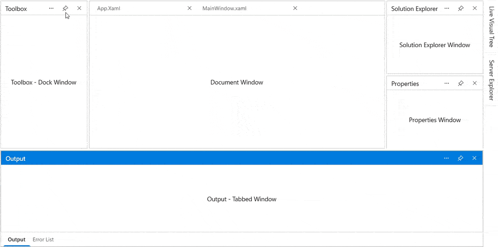

# Auto-Hide Panels in WinUI DockingManager

The DockingManager control allows panes to be automatically hidden when they are not in use. Auto-hidden panes remain accessible through edge tabs and can be displayed temporarily when selected.

This behavior helps maximize the available workspace while keeping important tool windows easily accessible.

## Auto-Hide a Pane

A pane can be displayed as an auto-hidden window by setting its [DockState](https://help.syncfusion.com/cr/winui/Syncfusion.UI.Xaml.Docking.DockPane.html#Syncfusion_UI_Xaml_Docking_DockPane_DockState) property to `AutoHidden`.




<Grid>
    <docking:SfDockingManager>
         <!-- Left Docked -->
        <docking:DockPane x:Name="ToolBoxPane"
                Header="Toolbox"
                DockDirection="Left"
                DockState="AutoHidden">
            <TextBlock Text="Toolbox Content" Margin="10"/>
        </docking:DockPane>
        <!-- Right Docked -->
        <docking:DockPane x:Name="SolutionExplorerPane"
                Header="Solution Explorer"
                DockDirection="Right"
                DockState="Docked">
            <TextBlock Text="Solution Explorer Content" Margin="10"/>
        </docking:DockPane>
        <!-- Bottom Docked -->
        <docking:DockPane x:Name="OutputPane"
                Header="Output"
                DockDirection="Bottom"
                DockState="Docked">
            <TextBlock Text="Build Output Window" Margin="10"/>
        </docking:DockPane>
        <!-- Another Document Window -->
        <docking:DockPane x:Name="Document2"
                Header="App.xaml"
                DockState="Document">
            <TextBox AcceptsReturn="True"
        Text="Another document..."
        Margin="5"/>
        </docking:DockPane>
    </docking:SfDockingManager>
</Grid>





DockPane toolBoxPane = new DockPane()
{
    Header = "Toolbox",
    DockDirection = Dock.Left,
    DockState = DockState.Docked,
    Content = new TextBlock()
    {
        Text = "Toolbox Content"
    }
};
DockPane SolutionExplorerPane = new DockPane()
{
    Header = "Solution Explorer",
    DockDirection = Dock.Right,
    DockState = DockState.Docked,
    Content = new TextBlock()
    {
        Text = "Solution Explorer Content"
    }
};
DockPane OutputPane = new DockPane()
{
    Header = "Output",
    DockDirection = Dock.Bottom,
    DockState = DockState.Docked,
    Content = new TextBlock()
    {
        Text = "Output Content"
    }
};
DockPane documentPane = new DockPane()
{
    Header = "App.xaml",
    DockDirection = Dock.Left,
    DockState = DockState.Docked,
    Content = new TextBlock()
    {
        Text = "App.xaml Content"
    }
};

dockingManager.Panes.Add(toolBoxPane);
dockingManager.Panes.Add(SolutionExplorerPane);
dockingManager.Panes.Add(OutputPane);
dockingManager.Panes.Add(documentPane);




## Prevent a Pane from Auto-Hiding

Set the [AllowAutoHide](https://help.syncfusion.com/cr/winui/Syncfusion.UI.Xaml.Docking.DockPane.html#Syncfusion_UI_Xaml_Docking_DockPane_AllowAutoHide) property of the pane to `false` to prevent it from being auto-hidden. The default value is `true`. The [AutoHidePane](https://help.syncfusion.com/cr/winui/Syncfusion.UI.Xaml.Docking.SfDockingManager.html#Syncfusion_UI_Xaml_Docking_SfDockingManager_AutoHidePane_Syncfusion_UI_Xaml_Docking_DockPane_) method and the pane header menu then leave the pane in its current state. For more information, see [Window States](https://help.syncfusion.com/winui/docking-manager/window-states).




<docking:DockPane Header="Toolbox"
                  DockDirection="Left"
                  DockState="Docked"
                  AllowAutoHide="False">
    <TextBlock Text="Toolbox Content"/>
</docking:DockPane>





DockPane toolboxPane = new DockPane()
{
    Header = "Toolbox",
    DockDirection = Dock.Left,
    DockState = DockState.Docked,
    AllowAutoHide = false
};




## Auto-Hide a Pane Programmatically

Use the [AutoHidePane](https://help.syncfusion.com/cr/winui/Syncfusion.UI.Xaml.Docking.SfDockingManager.html#Syncfusion_UI_Xaml_Docking_SfDockingManager_AutoHidePane_Syncfusion_UI_Xaml_Docking_DockPane_) method to auto-hide a docked pane at runtime, and the `RestorePane` method to return it to the docked layout. See [Pane Management](https://help.syncfusion.com/winui/docking-manager/pane-management).



dockingManager.AutoHidePane(toolboxPane);

dockingManager.RestorePane(toolboxPane);



N> [View Sample in GitHub](https://github.com/SyncfusionExamples/winui-sfdockingmanager-samples/tree/master/Samples/AutoHide)