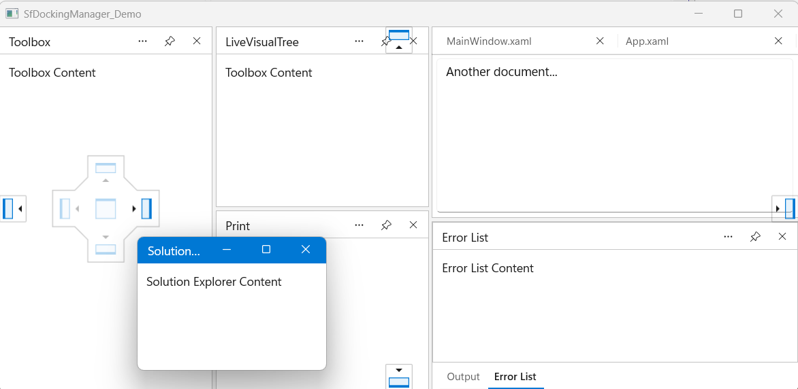
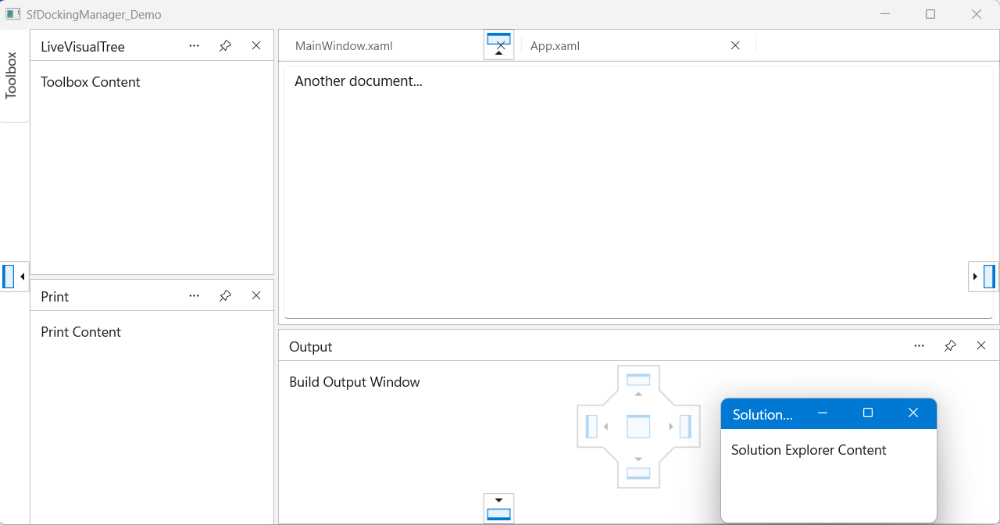
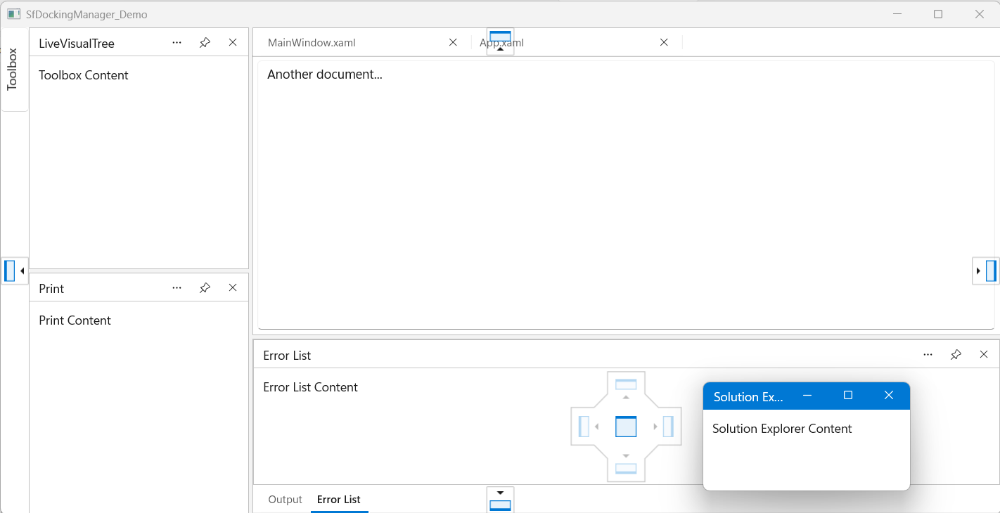

# Dock Ability in WinUI DockingManager

The `DockAbility` property of `DockPane` controls where a pane can be dropped during drag-and-drop operations. Use it to prevent users from docking a pane to unsupported regions, for example to keep a tool window on the horizontal edges only.

`DockAbility` is a flags enumeration, so values can be combined with the bitwise OR operator. The default value is `All`.

| Value | Description |
|-------|-------------|
| `None` | The pane cannot be docked through drag-and-drop. |
| `Left` | The pane can be docked to the left edge. |
| `Top` | The pane can be docked to the top edge. |
| `Right` | The pane can be docked to the right edge. |
| `Bottom` | The pane can be docked to the bottom edge. |
| `Document` | The pane can be dropped into the document area. |
| `Tabbed` | The pane can be tabbed with other docked or floating panes. |
| `All` | All docking abilities are enabled. This is the default value. |

## Restrict docking to specific edges

The following example allows the **Toolbox** pane to be docked only to the left or right edge.




<Grid>
    <docking:SfDockingManager>

        <docking:DockPane Header="Toolbox"
                          DockDirection="Left"
                          DockState="Docked"
                          DockAbility="Right">
            <TextBlock Text="Toolbox Content"/>
        </docking:DockPane>

        <docking:DockPane Header="MainWindow.xaml"
                          DockState="Document">
            <TextBox Text="Main document editor..."
                     AcceptsReturn="True"/>
        </docking:DockPane>

    </docking:SfDockingManager>
</Grid>





DockPane toolboxPane = new DockPane()
{
    Header = "Toolbox",
    DockDirection = Dock.Left,
    DockState = DockState.Docked,
    DockAbility = DockAbility.Right,
    Content = new TextBlock() { Text = "Toolbox Content" }
};

DockPane documentPane = new DockPane()
{
    Header = "MainWindow.xaml",
    DockState = DockState.Document
};

dockingManager.Panes.Add(toolboxPane);
dockingManager.Panes.Add(documentPane);




## Disable docking through drag-and-drop

Set `DockAbility` to `None` to prevent a pane from being docked through drag-and-drop.




<docking:DockPane Header="Output"
                  DockDirection="Bottom"
                  DockState="Docked"
                  DockAbility="None">
    <TextBlock Text="Build Output Window"/>
</docking:DockPane>





DockPane outputPane = new DockPane()
{
    Header = "Output",
    DockDirection = Dock.Bottom,
    DockState = DockState.Docked,
    DockAbility = DockAbility.None
};




## Control document and tab targets

Dropping a pane on the center of a target depends on the target type:

* Over the document area, the `Document` flag is required.
* Over a docked pane or a floating window, the `Tabbed` flag is required.

The following example allows a pane to be tabbed with other panes, but not to be dropped into the document area or on the outer edges.




<docking:DockPane Header="Error List"
                  DockDirection="Bottom"
                  DockState="Docked"
                  DockAbility="Tabbed">
    <TextBlock Text="Error List Content"/>
</docking:DockPane>





DockPane errorListPane = new DockPane()
{
    Header = "Error List",
    DockDirection = Dock.Bottom,
    DockState = DockState.Docked,
    DockAbility = DockAbility.Tabbed
};




N> Dock hints for targets that `DockAbility` does not permit are not displayed, and dropping on them is ignored.

N> `DockAbility` restricts only drag-and-drop operations. Changing `DockState` or `DockDirection` in code, or calling methods such as `AddPane` and `SetPaneState`, is not restricted. To restrict floating and auto-hiding, use `AllowFloat` and `AllowAutoHide`. See [Window States](Window-States.md).
