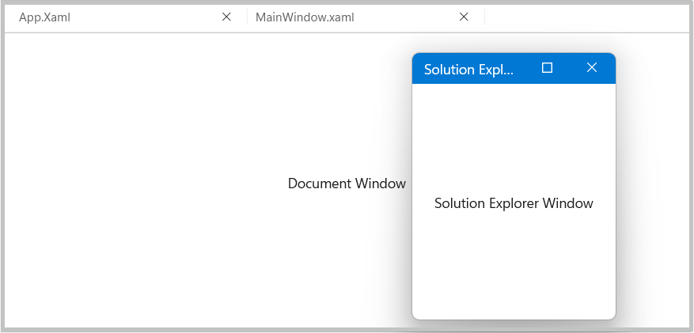
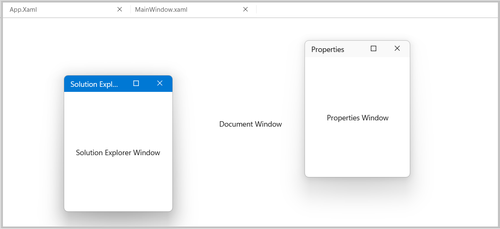

# Floating Windows in WinUI DockingManager

The DockingManager control allows panes to be displayed as floating windows. Floating windows can be moved independently within the DockingManager layout, providing greater flexibility for organizing content and customizing the workspace.

## Create a Floating Window

A pane can be displayed as a floating window by setting its [DockState](https://help.syncfusion.com/cr/winui/Syncfusion.UI.Xaml.Docking.DockPane.html#Syncfusion_UI_Xaml_Docking_DockPane_DockState) property to `Floating`.




<Grid>
    <docking:SfDockingManager>

        <docking:DockPane Header="MainWindow.xaml"
                          DockState="Document">
            <TextBox Text="Main document editor..."
                     AcceptsReturn="True"/>
        </docking:DockPane>

        <docking:DockPane Header="Solution Explorer"
                          DockState="Floating">
            <TextBlock Text="Solution Explorer Content"/>
        </docking:DockPane>

    </docking:SfDockingManager>
</Grid>





DockPane documentPane = new DockPane()
{
    Header = "MainWindow.xaml",
    DockState = DockState.Document
};

DockPane floatingPane = new DockPane()
{
    Header = "Solution Explorer",
    DockState = DockState.Floating,
    Content = new TextBlock()
    {
        Text = "Solution Explorer Content"
    }
};

dockingManager.Panes.Add(documentPane);
dockingManager.Panes.Add(floatingPane);




## Floating Multiple Windows

The DockingManager control supports multiple floating windows within the same layout. Floating windows can be positioned independently and rearranged to suit different workspace requirements.




<Grid>
    <docking:SfDockingManager>

        <docking:DockPane Header="MainWindow.xaml"
                          DockState="Document">
            <TextBox Text="Main document editor..."
                     AcceptsReturn="True"/>
        </docking:DockPane>

        <docking:DockPane Header="Solution Explorer"
                          DockState="Floating">
            <TextBlock Text="Solution Explorer Content"/>
        </docking:DockPane>

        <docking:DockPane Header="ToolBox"
                          DockState="Floating">
            <TextBlock Text="ToolBox Window"/>
        </docking:DockPane>

    </docking:SfDockingManager>
</Grid>





DockPane documentPane = new DockPane()
{
    Header = "MainWindow.xaml",
    DockState = DockState.Document
};

DockPane solutionExplorerPane = new DockPane()
{
    Header = "Solution Explorer",
    DockState = DockState.Floating
};

DockPane toolBoxPane = new DockPane()
{
    Header = "ToolBox",
    DockState = DockState.Floating
};

dockingManager.Panes.Add(documentPane);
dockingManager.Panes.Add(solutionExplorerPane);
dockingManager.Panes.Add(toolBoxPane);




## Prevent a Pane from Floating

Set the [AllowFloat](https://help.syncfusion.com/cr/winui/Syncfusion.UI.Xaml.Docking.DockPane.html#Syncfusion_UI_Xaml_Docking_DockPane_AllowFloat) property of the pane to `false` to prevent it from being displayed as a floating window. The default value is `true`. The [FloatPane](https://help.syncfusion.com/cr/winui/Syncfusion.UI.Xaml.Docking.SfDockingManager.html#Syncfusion_UI_Xaml_Docking_SfDockingManager_FloatPane_Syncfusion_UI_Xaml_Docking_DockPane_) method and the pane header menu then leave the pane in its current state. For more information, see [Window States](https://help.syncfusion.com/winui/docking-manager/window-states).




<docking:DockPane Header="Toolbox"
                  DockDirection="Left"
                  DockState="Docked"
                  AllowFloat="False">
    <TextBlock Text="Toolbox Content"/>
</docking:DockPane>





DockPane toolboxPane = new DockPane()
{
    Header = "Toolbox",
    DockDirection = Dock.Left,
    DockState = DockState.Docked,
    AllowFloat = false
};




## Float a Pane Programmatically

Use the [FloatPane](https://help.syncfusion.com/cr/winui/Syncfusion.UI.Xaml.Docking.SfDockingManager.html#Syncfusion_UI_Xaml_Docking_SfDockingManager_FloatPane_Syncfusion_UI_Xaml_Docking_DockPane_) method to move a docked pane to a floating window at runtime, and the [RestorePane](https://help.syncfusion.com/cr/winui/Syncfusion.UI.Xaml.Docking.SfDockingManager.html#Syncfusion_UI_Xaml_Docking_SfDockingManager_RestorePane_Syncfusion_UI_Xaml_Docking_DockPane_) method to return it to the docked layout. See [Pane Management](https://help.syncfusion.com/winui/docking-manager/pane-management).



dockingManager.FloatPane(toolboxPane);

dockingManager.RestorePane(toolboxPane);


N> [View Sample in GitHub](https://github.com/SyncfusionExamples/winui-sfdockingmanager-samples/tree/master/Samples/FloatingWindows)