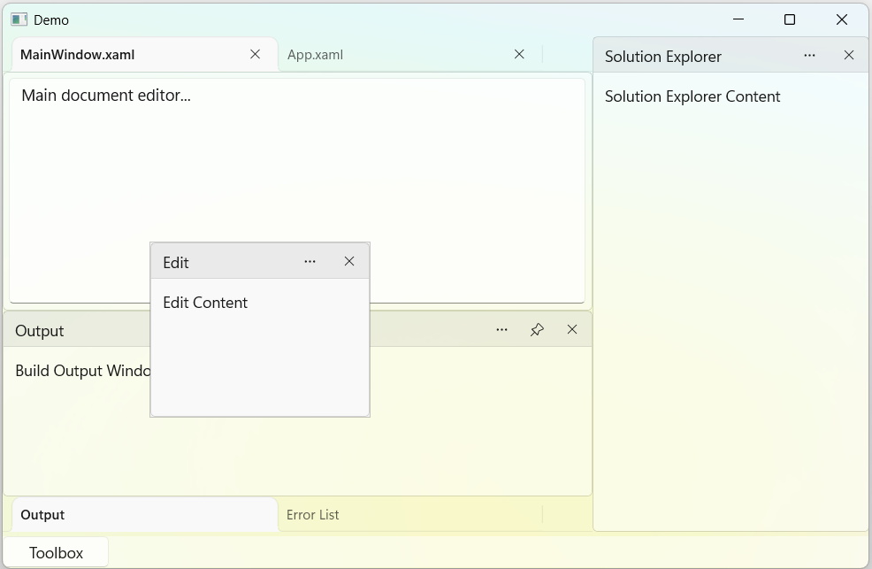

# Getting Started with WinUI Docking Control

This section explains how to create a WinUI application with the Docking control and add docked and document windows.

## Creating an application with WinUI Docking

1. Create a WinUI 3 desktop application using C# and .NET 8 or later. For step-by-step instructions, see the [Create a WinUI 3 desktop app](https://learn.microsoft.com/en-us/windows/apps/winui/winui3/create-your-first-winui3-app) guide.

2. Add a reference to the `Syncfusion.DockingManager.WinUI` NuGet package using one of the following methods:

    * **Package Manager Console**: Run `Install-Package Syncfusion.DockingManager.WinUI`.
    * **.NET CLI**: Run `dotnet add package Syncfusion.DockingManager.WinUI`.
    * **Visual Studio**: Right-click the project, choose Manage NuGet Packages, search for `Syncfusion.DockingManager.WinUI`, and click Install.

3. Import the control namespace `Syncfusion.UI.Xaml.Docking` in XAML or C# code.

N> The XAML samples in this document use `<Window>` as the root element because the control targets WinUI 3 desktop applications.

### Initialize the DockingManager

Add the `SfDockingManager` control to the page or window.




<Window
    x:Class="GettingStarted.MainWindow"
    xmlns="http://schemas.microsoft.com/winfx/2006/xaml/presentation"
    xmlns:x="http://schemas.microsoft.com/winfx/2006/xaml"
    xmlns:docking="using:Syncfusion.UI.Xaml.Docking">

    <Grid>
        <docking:SfDockingManager x:Name="dockingManager"/>
    </Grid>

</Window>




using Syncfusion.UI.Xaml.Docking;

public sealed partial class MainWindow : Window
{
    public MainWindow()
    {
        InitializeComponent();

        SfDockingManager dockingManager = new SfDockingManager();
        Content = dockingManager;
    }
}




## Add dock panes

The `DockPane` is the basic element of the DockingManager control. It hosts content and can be displayed in different docking states.

The following example demonstrates how to add docked and document panes.




<Grid>
    <docking:SfDockingManager>

        <docking:DockPane Header="Toolbox"
                          DockDirection="Left"
                          DockState="Docked">
            <TextBlock Text="Toolbox Content"/>
        </docking:DockPane>

        <docking:DockPane Header="Solution Explorer"
                          DockDirection="Right"
                          DockState="Docked">
            <TextBlock Text="Solution Explorer Content"/>
        </docking:DockPane>

        <docking:DockPane Header="MainWindow.xaml"
                          DockState="Document">
            <TextBox AcceptsReturn="True"
                     Text="Main document editor..."/>
        </docking:DockPane>

    </docking:SfDockingManager>
</Grid>




## Dock states

The DockingManager control supports the following docking states:

* **Docked** - Displays a pane in one of the four dock regions (Left, Right, Top, or Bottom).
* **Document** - Displays a pane in the document area.
* **Floating** - Displays a pane in a separate floating window.
* **AutoHidden** - Hides a pane until it is activated.
* **Tabbed** - Groups panes within a tabbed layout.

## Create tab groups

Use the `TargetNameInTabbedState` property to group a pane with another existing pane. The grouped panes appear together in a tabbed layout.




<docking:DockPane x:Name="OutputPane"
                  Header="Output"
                  DockDirection="Bottom"
                  DockState="Docked">
    <TextBlock Text="Output Content"/>
</docking:DockPane>

<docking:DockPane Header="Error List"
                  DockDirection="Bottom"
                  DockState="Tabbed"
                  TargetNameInTabbedState="OutputPane">
    <TextBlock Text="Error List Content"/>
</docking:DockPane>




SfDockingManager dockingManager = new SfDockingManager();

DockPane outputPane = new DockPane()
{
    Name = "OutputPane",
    Header = "Output",
    DockDirection = DockDirection.Bottom,
    DockState = DockState.Docked,
    Content = new TextBlock() { Text = "Output Content" }
};

DockPane errorListPane = new DockPane()
{
    Header = "Error List",
    DockDirection = DockDirection.Bottom,
    DockState = DockState.Tabbed,
    TargetNameInTabbedState = "OutputPane",
    Content = new TextBlock() { Text = "Error List Content" }
};

dockingManager.Children.Add(outputPane);
dockingManager.Children.Add(errorListPane);




## Add document panes

A document pane is hosted in the document area of the layout. Set the `DockState` property to `Document`.




<docking:DockPane Header="MainWindow.xaml"
                  DockState="Document">
    <TextBox AcceptsReturn="True"
             Text="Main document editor..."/>
</docking:DockPane>




SfDockingManager dockingManager = new SfDockingManager();

DockPane documentPane = new DockPane()
{
    Header = "MainWindow.xaml",
    DockState = DockState.Document,
    Content = new TextBox()
    {
        AcceptsReturn = true,
        Text = "Main document editor..."
    }
};

dockingManager.Children.Add(documentPane);




## Add a floating window

A pane can be displayed in a floating window by setting its `DockState` to `Floating`. The pane detaches from the main layout and appears in its own movable window.




<docking:DockPane Header="Properties"
                  DockState="Floating">
    <TextBlock Text="Properties Window"/>
</docking:DockPane>




SfDockingManager dockingManager = new SfDockingManager();

DockPane propertiesPane = new DockPane()
{
    Header = "Properties",
    DockState = DockState.Floating,
    Content = new TextBlock() { Text = "Properties Window" }
};

dockingManager.Children.Add(propertiesPane);


