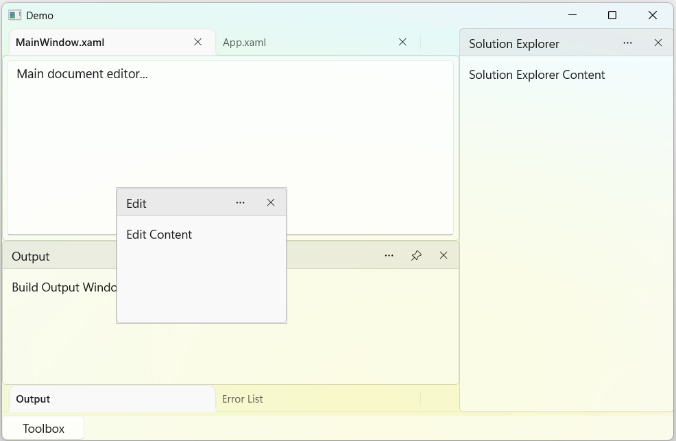
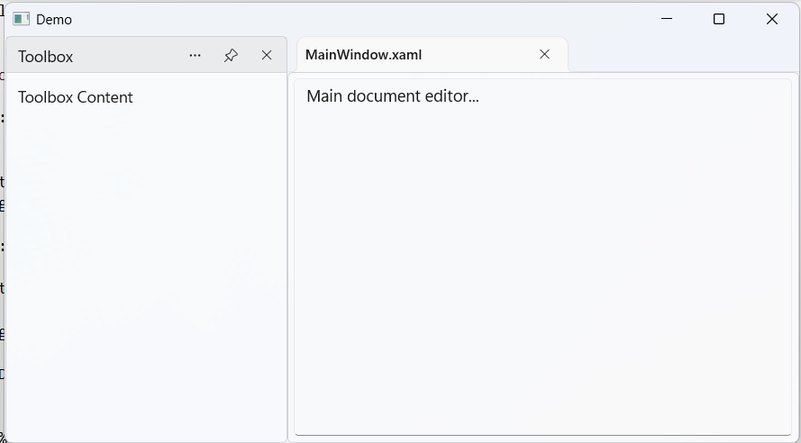
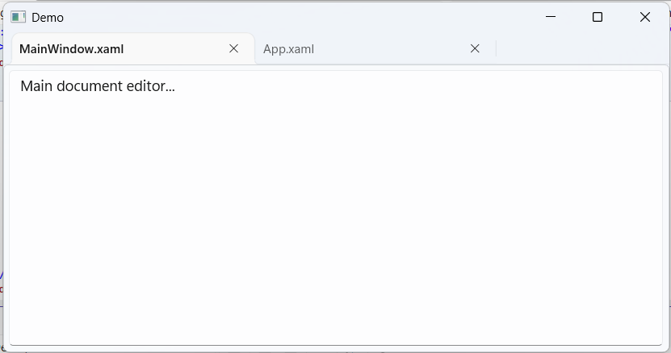
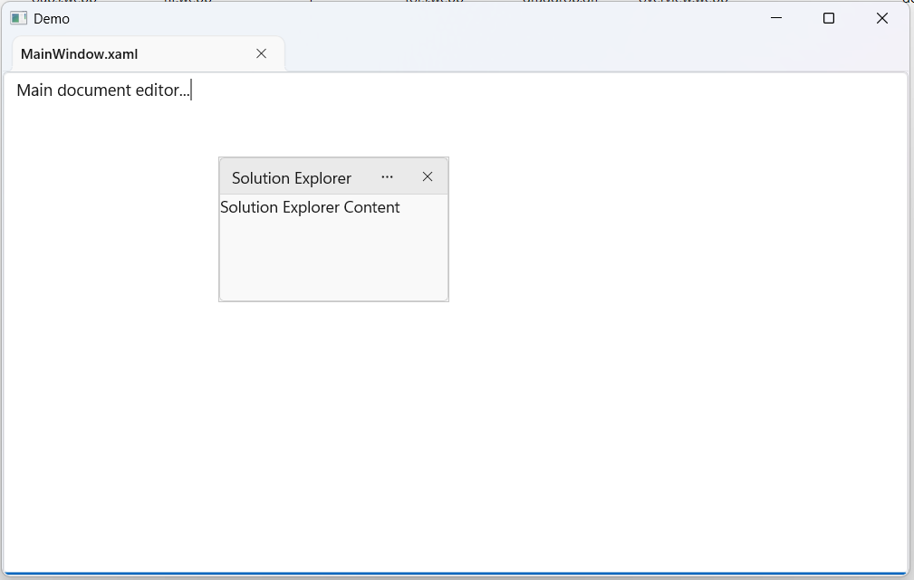
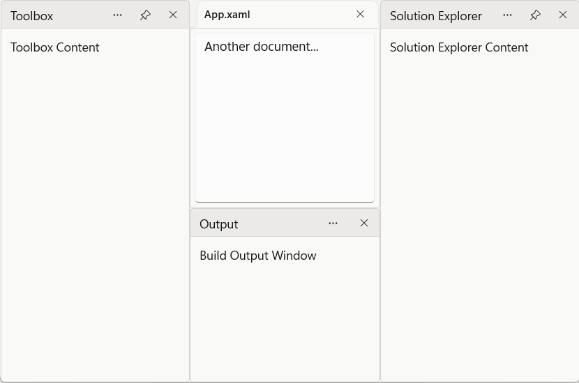
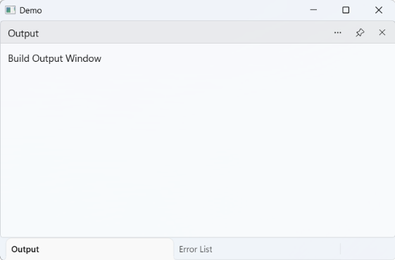

# Window States in WinUI DockingManager

The DockingManager control supports multiple window states that help organize application content into flexible and customizable layouts. Each state determines how a pane is displayed and interacts with other panes within the docking layout.

The following window states are supported:

* Docked
* Document
* Floating
* AutoHidden
* Tabbed

## Docked Window

A docked window is attached to one of the docking regions such as the left, right, top, or bottom side of the layout. Docked windows are commonly used for tool windows and navigation panels.




<Grid>
    <docking:SfDockingManager>

        <docking:DockPane Header="Toolbox"
                          DockDirection="Left"
                          DockState="Docked">
            <TextBlock Text="Toolbox Content"/>
        </docking:DockPane>

        <docking:DockPane Header="MainWindow.xaml"
                          DockState="Document">
            <TextBox Text="Main document editor..."
                     AcceptsReturn="True"/>
        </docking:DockPane>

    </docking:SfDockingManager>
</Grid>





DockPane toolboxPane = new DockPane()
{
    Header = "Toolbox",
    DockDirection = Dock.Left,
    DockState = DockState.Docked,
    Content = new TextBlock()
    {
        Text = "Toolbox Content"
    }
};

DockPane documentPane = new DockPane()
{
    Header = "MainWindow.xaml",
    DockState = DockState.Document
};

dockingManager.Panes.Add(toolboxPane);
dockingManager.Panes.Add(documentPane);




## Document Window

A document window is displayed in the central document area and is commonly used to host editable content such as source files, documents, and design surfaces.




<Grid>
    <docking:SfDockingManager>

        <docking:DockPane Header="MainWindow.xaml"
                          DockState="Document">
            <TextBox Text="Main document editor..."
                     AcceptsReturn="True"/>
        </docking:DockPane>

        <docking:DockPane Header="App.xaml"
                          DockState="Document">
            <TextBox Text="Application resources..."
                     AcceptsReturn="True"/>
        </docking:DockPane>

    </docking:SfDockingManager>
</Grid>





DockPane documentPane1 = new DockPane()
{
    Header = "MainWindow.xaml",
    DockState = DockState.Document
};

DockPane documentPane2 = new DockPane()
{
    Header = "App.xaml",
    DockState = DockState.Document
};

dockingManager.Panes.Add(documentPane1);
dockingManager.Panes.Add(documentPane2);




## Floating Window

A floating window is displayed outside the docking layout and can be moved independently across the desktop.




<Grid>
    <docking:SfDockingManager>

        <docking:DockPane Header="MainWindow.xaml"
                          DockState="Document">
            <TextBox Text="Main document editor..."
                     AcceptsReturn="True"/>
        </docking:DockPane>

        <docking:DockPane Header="Solution Explorer"
                          DockState="Floating">
            <TextBlock Text="Solution Explorer Content"/>
        </docking:DockPane>

    </docking:SfDockingManager>
</Grid>





DockPane documentPane = new DockPane()
{
    Header = "MainWindow.xaml",
    DockState = DockState.Document
};

DockPane floatingPane = new DockPane()
{
    Header = "Solution Explorer",
    DockState = DockState.Floating,
    Content = new TextBlock()
    {
        Text = "Solution Explorer Content"
    }
};

dockingManager.Panes.Add(documentPane);
dockingManager.Panes.Add(floatingPane);




## Auto-Hidden Window

An auto-hidden window remains collapsed along the edge of the layout and expands temporarily when selected.




<Grid>
    <docking:SfDockingManager>

        <docking:DockPane Header="Toolbox"
                          DockDirection="Left"
                          DockState="AutoHidden">
            <TextBlock Text="Toolbox Content"/>
        </docking:DockPane>

        <docking:DockPane Header="MainWindow.xaml"
                          DockState="Document">
            <TextBox Text="Main document editor..."
                     AcceptsReturn="True"/>
        </docking:DockPane>

    </docking:SfDockingManager>
</Grid>





DockPane autoHiddenPane = new DockPane()
{
    Header = "Toolbox",
    DockDirection = Dock.Left,
    DockState = DockState.AutoHidden,
    Content = new TextBlock()
    {
        Text = "Toolbox Content"
    }
};

DockPane documentPane = new DockPane()
{
    Header = "MainWindow.xaml",
    DockState = DockState.Document
};

dockingManager.Panes.Add(autoHiddenPane);
dockingManager.Panes.Add(documentPane);




## Tabbed Window

A tabbed window groups multiple panes within the same docking region and displays them as tabs.




<Grid>
    <docking:SfDockingManager>

        <docking:DockPane x:Name="OutputPane"
                          Header="Output"
                          DockDirection="Bottom"
                          DockState="Docked">
            <TextBlock Text="Output Content"/>
        </docking:DockPane>

        <docking:DockPane Header="Error List"
                          DockDirection="Bottom"
                          DockState="Tabbed"
                          TargetNameInTabbedState="OutputPane">
            <TextBlock Text="Error List Content"/>
        </docking:DockPane>

    </docking:SfDockingManager>
</Grid>





DockPane outputPane = new DockPane()
{
    Name = "OutputPane",
    Header = "Output",
    DockDirection = Dock.Bottom,
    DockState = DockState.Docked
};

DockPane errorListPane = new DockPane()
{
    Header = "Error List",
    DockDirection = Dock.Bottom,
    DockState = DockState.Tabbed,
    TargetNameInTabbedState = "OutputPane"
};

dockingManager.Panes.Add(outputPane);
dockingManager.Panes.Add(errorListPane);




## Hidden Window

A hidden pane is closed and not displayed, but it remains part of the DockingManager so that it can be restored later. Use the `HidePane` method to hide a pane and the `RestorePane` method to display it again in the docked layout.



dockingManager.HidePane(toolboxPane);

dockingManager.RestorePane(toolboxPane);



N> `HidePane` raises the `PaneClosing` and `PaneClosed` events. See [Events](Events.md).

## Restrict Floating and Auto-Hiding

Use the `AllowFloat` and `AllowAutoHide` properties of `DockPane` to control whether a pane can enter the `Floating` or `AutoHidden` state. Both properties are `true` by default.

| Property | Description |
|----------|-------------|
| `AllowFloat` | When `false`, the pane cannot be floated. |
| `AllowAutoHide` | When `false`, the pane cannot be auto-hidden. |




<Grid>
    <docking:SfDockingManager>

        <docking:DockPane Header="Toolbox"
                          DockDirection="Left"
                          DockState="Docked"
                          AllowFloat="False"
                          AllowAutoHide="False">
            <TextBlock Text="Toolbox Content"/>
        </docking:DockPane>

        <docking:DockPane Header="MainWindow.xaml"
                          DockState="Document">
            <TextBox Text="Main document editor..."
                     AcceptsReturn="True"/>
        </docking:DockPane>

    </docking:SfDockingManager>
</Grid>





DockPane toolboxPane = new DockPane()
{
    Header = "Toolbox",
    DockDirection = Dock.Left,
    DockState = DockState.Docked,
    AllowFloat = false,
    AllowAutoHide = false,
    Content = new TextBlock() { Text = "Toolbox Content" }
};

dockingManager.Panes.Add(toolboxPane);




When a state is not allowed:

* The corresponding command is unavailable in the pane header menu.
* The `FloatPane`, `AutoHidePane`, and `SetPaneState` methods leave the pane in its current state.
* A pane that requests the `Floating` or `AutoHidden` state while being added is placed in the `Docked` state instead.
* The state is not applied when a saved layout is loaded. See [Layout Serialization](Serialization.md).

The properties can also be changed at runtime, and the header menu updates accordingly.

N> To restrict the drag-and-drop targets of a pane, see [Dock Ability](Dock-Ability.md).
