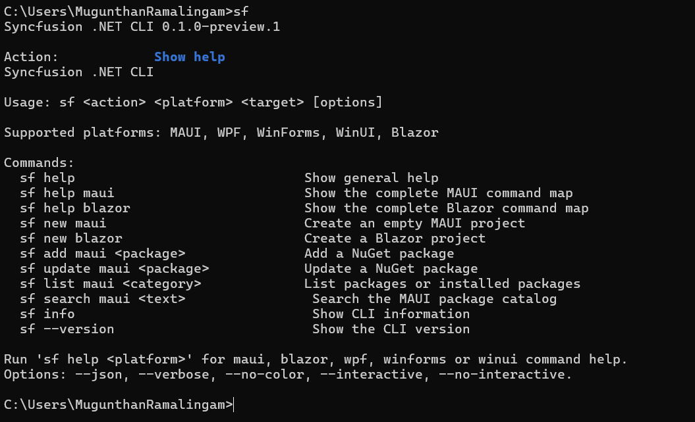
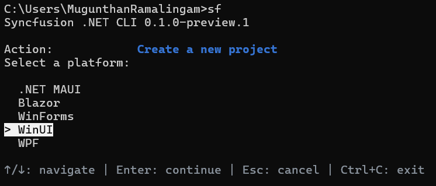
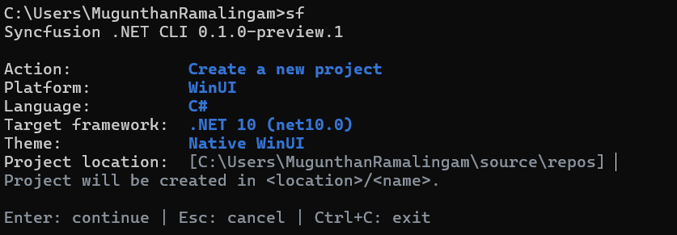
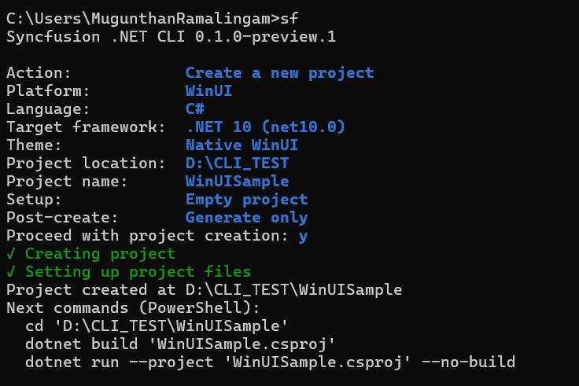
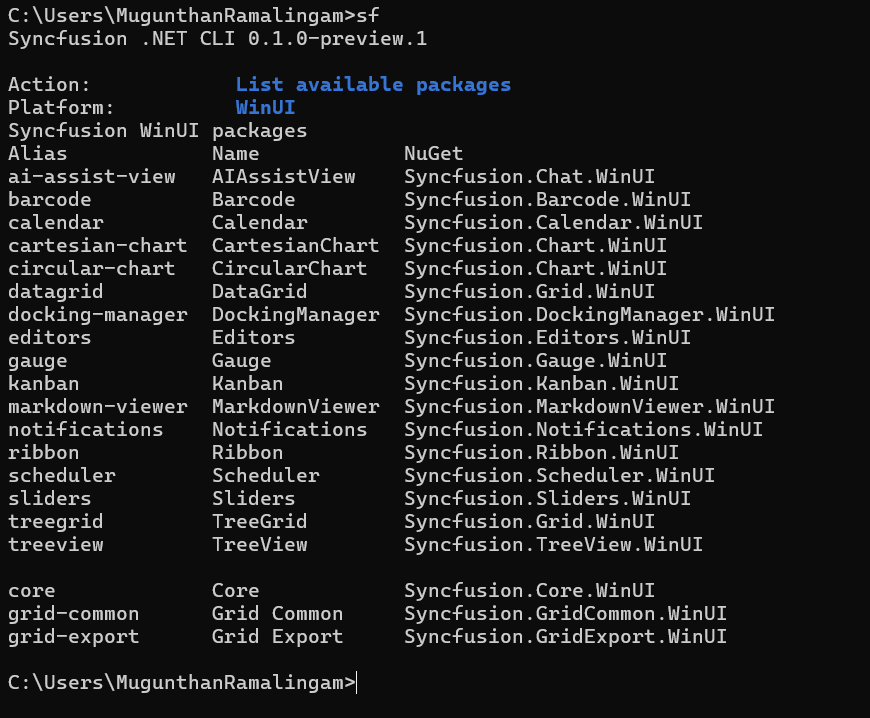

# Overview of the Syncfusion<sup>®</sup> .NET CLI

The Syncfusion<sup>®</sup> .NET CLI (`sf`) is a cross-platform command line tool that creates WinUI 3 projects and manages Syncfusion<sup>®</sup> WinUI NuGet packages from a terminal. After you install the CLI, you can run `sf` with no arguments to open an interactive menu, or run a direct command such as `sf new winui` for scripted, prompt-free creation.

N> The Syncfusion<sup>®</sup> .NET CLI is currently in preview and is installed with the `--prerelease` flag.

You can use the CLI to perform the following actions:

* Create a blank WinUI 3 app, or an app containing generated Syncfusion<sup>®</sup> control samples.
* Add or update Syncfusion<sup>®</sup> WinUI NuGet package references in an existing project.
* List available and installed packages, and search the package catalog.
* Generate projects for .NET MAUI, Blazor, WPF, WinForms, and WinUI 3.

This documentation covers the WinUI 3 platform.

## Prerequisites

The following software is required before you install and use the CLI:

* [.NET SDK](https://dotnet.microsoft.com/download). The SDK selected through `PATH` takes precedence, with the running .NET installation as a fallback.
* A Windows development environment. WinUI 3 projects use the Windows App SDK, and building and launching the generated apps require Windows.
* An internet connection so package operations can reach [nuget.org](https://www.nuget.org).

N> Syncfusion<sup>®</sup> packages resolve from the official nuget.org feed, `https://api.nuget.org/v3/index.json`. The CLI accepts only this source through `--source`.

N> The CLI does not require an installed `dotnet new winui` template. WinUI projects use an unpackaged, self-contained Windows App SDK application pattern with a minimum Windows 10 build of 19041 and a win-x64 runtime identifier.

## Installation

The CLI is published as a .NET global tool with the package ID `Syncfusion.DotNet.CLI`.

1. Open a terminal and run the following command. Add `--prerelease` while only preview versions are available.

    ```bash
    dotnet tool install -g Syncfusion.DotNet.CLI --prerelease
    ```

2. Verify the installation and print the CLI version.

    ```bash
    sf --version
    ```

To update the tool to the latest release, run:

```bash
dotnet tool update -g Syncfusion.DotNet.CLI --prerelease
```

To remove the tool, run:

```bash
dotnet tool uninstall -g Syncfusion.DotNet.CLI
```

## Initialize the CLI

Run `sf` in an interactive terminal to open the main menu. The menu shows the current CLI version and groups the available operations.


| Group | Operation | Command reference |
| --- | --- | --- |
| Project creation | Create a new project | `sf new` |
| Package management | Add a package to an existing project | `sf add` |
| Package management | Update a package in an existing project | `sf update` |
| Discovery | List available packages | `sf list <platform> packages` |
| Discovery | List installed packages in an existing project | `sf list <platform> installed` |
| Discovery | Search for packages | `sf search` |
| Help and information | View CLI information | `sf info` |
| Help and information | Show help | `sf help` |
| Exit | Exit | `Ctrl+C` |

N> The `<platform>` text is a usage placeholder. Use `winui` for WinUI 3.

Use the following keys to navigate the interactive screens:

| Key | Action |
| --- | --- |
| Up / Down | Move through the options |
| Enter | Choose the focused option, or continue |
| Space | Toggle a checkbox in a multi-selection list |
| Escape | Cancel the current question and return to the menu |
| `Ctrl+C` | Exit the interactive session |

Complete direct commands remain usable without opening the menu. `--no-interactive` disables prompts in any command.

## Available commands

| Command | Purpose |
| --- | --- |
| `sf new winui` | Create a new WinUI 3 project |
| `sf add winui <package>` | Add a Syncfusion<sup>®</sup> package to an existing project |
| `sf update winui <package>` | Update a package in an existing project |
| `sf list winui packages` | List available packages |
| `sf list winui installed` | List installed packages in an existing project |
| `sf search winui <text>` | Search packages |
| `sf info` | Show CLI information |
| `sf help winui` | Show the WinUI command map |
| `sf --version` | Show the CLI version |



## Create a WinUI 3 project

You can create a WinUI 3 project through the interactive wizard or a direct command. WinUI projects are created with C#, and the theme is the native WinUI theme.

### Create a project using the interactive wizard

Run `sf new`, or select **Create a new project** from the main menu. The WinUI creation flow is:

1. **Platform:** Select **WinUI**.

    

2. **Framework:** Select the .NET version.

    * .NET 10 (`net10.0`), the default
    * .NET 9 (`net9.0`)
    * .NET 8 (`net8.0`)

3. **Location and name:** Enter the parent directory and the project name. The suggested name is `SyncfusionWinUIApp`, and the first available numeric suffix is used when the destination name collides.

4. **Setup:** Select **Blank app** or **Include Syncfusion controls**.

5. **Controls:** When you include controls, choose one or more controls from the list. Controls start unchecked, and at least one selection is required.

    

6. **Post-create:** Select **Generate only** or **Build project**.
7. **Confirmation:** Review the selected values and confirm to create the project.

N> A complete direct command does not open the wizard. When a name is missing in an interactive terminal, the wizard supplies a default and collects the remaining unspecified inputs. Missing required values in scripts produce an error.

N> On macOS and Linux, use `--post-action generate` for portable source generation. The CLI explains that building and running WinUI apps requires Windows.

### Available controls

The following controls are available in a new WinUI 3 project:

| Control | Control ID | NuGet package |
| --- | --- | --- |
| AI AssistView | `ai-assist-view` | `Syncfusion.Chat.WinUI` |
| Cartesian Chart | `cartesian-chart` | `Syncfusion.Chart.WinUI` |
| Circular Chart | `circular-chart` | `Syncfusion.Chart.WinUI` |
| DataGrid | `datagrid` | `Syncfusion.Grid.WinUI` |
| DockingManager | `docking-manager` | `Syncfusion.DockingManager.WinUI` |
| Kanban | `kanban` | `Syncfusion.Kanban.WinUI` |
| Markdown Viewer | `markdown-viewer` | `Syncfusion.MarkdownViewer.WinUI` |
| Ribbon | `ribbon` | `Syncfusion.Ribbon.WinUI` |
| Scheduler | `scheduler` | `Syncfusion.Scheduler.WinUI` |
| TreeGrid | `treegrid` | `Syncfusion.Grid.WinUI` |
| TreeView | `treeview` | `Syncfusion.TreeView.WinUI` |

Each selected control generates its own XAML page and code-behind. Data-driven samples also include a view model. The DataGrid sample contains 50 editable orders across eight columns, the TreeGrid sample contains three teams with 21 employees, and the Chart sample contains 12 monthly sales points.

### Create a project using direct commands

To create a blank project without the wizard:

```bash
sf new winui -n MyApp
```

To create a project containing Syncfusion<sup>®</sup> control samples:

```bash
sf new winui -n MyApp --control datagrid
sf new winui -n MyApp --control datagrid chart treeview
sf new winui -n MyApp --control datagrid chart treegrid ribbon docking-manager
```

To select the .NET version and generate sources without restoring or building:

```bash
sf new winui --name MyApp --target-framework net9.0 --control empty --post-action generate --no-interactive
```

## Run the created project

After creation, the CLI prints a copyable **Next commands** block. Build and run the generated project on Windows:

```powershell
cd .\MyApp
dotnet run --project .\MyApp\MyApp.csproj --no-build
```

Native XAML compilation and runtime checks require Windows. Restore can run on other hosts; use `--post-action generate` there and build after copying the project to a Windows machine.



## Manage packages in an existing project

Package operations change NuGet references only. They do not generate control files.

`<package>` accepts a canonical package alias, a canonical package ID, or an exact unambiguous package display name:

```bash
sf add winui grid
sf add winui Syncfusion.Grid.WinUI
sf update winui chart --version 35.1.40
```

Package add and update support `-v/--version`, `--source`, `--configfile`, `--no-restore`, `--dry-run`, and `--force`. Existing-project commands accept `-p/--path` with a `.csproj` file, a project directory, or a supported subdirectory. `--json` emits one JSON document for script use.

To list the available WinUI packages:

```bash
sf list winui packages
```



To list the Syncfusion<sup>®</sup> packages installed in an existing project:

```bash
sf list winui installed -p .\MyApp\MyApp.csproj
```

To search the WinUI package catalog:

```bash
sf search winui chart
sf search chart --framework winui
```

N> WinUI projects retain package-only operations. Package operations never apply control registration based on package metadata.

## Options reference

### Creation options

| Option | Description |
| --- | --- |
| `-n`, `--name` | Project name. Required when prompting is unavailable |
| `-p`, `--path` | Parent directory. Defaults to the current directory |
| `-t`, `--target-framework` | The .NET target framework: `net10.0`, `net9.0`, or `net8.0` |
| `--control` | One or more control IDs, or `empty`. Omit to create an empty project |
| `--post-action` | Post-create action: `generate` or `build`. Defaults to `build` for direct commands |
| `--dry-run` | Preview the action without making changes |
| `--force` | Allow supported overwrites |
| `--no-restore` | Skip `dotnet restore` after the action |
| `--no-build` | Skip `dotnet build` after the action |
| `--no-interactive` | Disable interactive prompts |
| `--json` | Emit a JSON document instead of table output |

N> `--post-action build` conflicts with `--no-build`. Neither `--force` nor confirmation authorizes overwriting an existing project destination.

### Package operation options

| Option | Description |
| --- | --- |
| `-p`, `--path` | The project directory, `.csproj` file, or a supported subdirectory |
| `-v`, `--version` | The Syncfusion<sup>®</sup> NuGet package version |
| `--source` | Package source; Syncfusion<sup>®</sup> packages require `https://api.nuget.org/v3/index.json` |
| `--configfile` | The NuGet configuration file to use |
| `--dry-run` | Preview the action without making changes |
| `--force` | Allow supported overwrites |
| `--no-restore` | Skip `dotnet restore` after the action |
| `--json` | Emit one JSON document |

## Licensing

The CLI does not generate a license key. Syncfusion<sup>®</sup> licensing requirements continue to apply.

To register an existing license without writing values into generated sources, set the `SYNCFUSION_LICENSE_KEY` environment variable in the application environment. When controls are selected, generated apps read this variable and register the license at startup. Refer to the [WinUI licensing overview](https://help.syncfusion.com/winui/licensing/overview) to generate a license key.

## FAQs

**Does the CLI generate a license key?** No. Refer to the [licensing overview](https://help.syncfusion.com/winui/licensing/overview) to generate and register a license key in your project.

**Which .NET versions are supported for WinUI?** .NET 10 (`net10.0`), .NET 9 (`net9.0`), and .NET 8 (`net8.0`). C# is the supported language, and projects use the native WinUI theme.

**Can I build a WinUI project on macOS or Linux?** Use `--post-action generate` to generate the sources on other hosts. Building and launching require Windows because the projects use the Windows App SDK with a win-x64 runtime identifier.

**Why do DataGrid and TreeGrid share a package?** Both controls are provided by `Syncfusion.Grid.WinUI`. Use the control alias (`datagrid` or `treegrid`) to add the matching sample.

**Which platforms does the CLI support?** .NET MAUI, Blazor, WPF, WinForms, and WinUI 3. This documentation covers WinUI 3.

## See also

* [Syncfusion WinUI controls](https://www.syncfusion.com/winui-controls)
* [Syncfusion WinUI help documentation](https://help.syncfusion.com/winui/overview)
* [System requirements for WinUI](https://help.syncfusion.com/winui/system-requirements)
* [Windows App SDK unpackaged deployment](https://learn.microsoft.com/windows/apps/windows-app-sdk/deploy-unpackaged-apps)